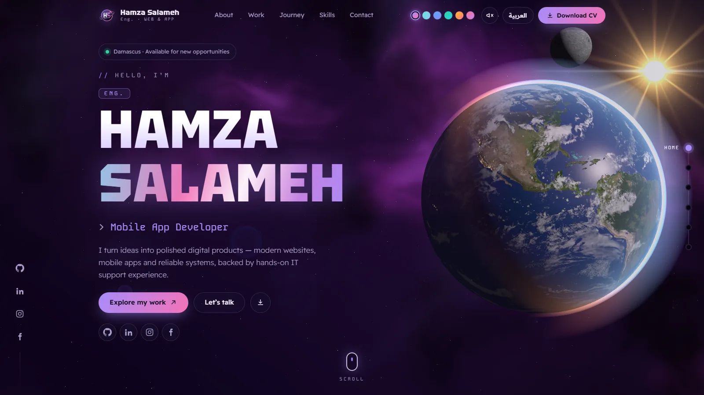
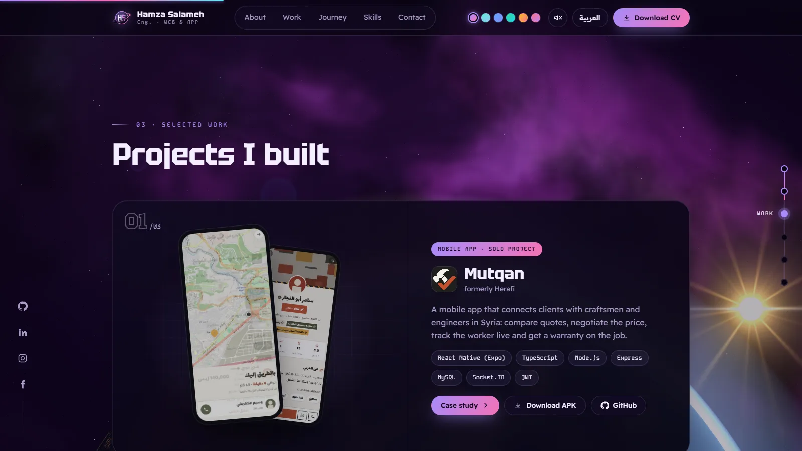
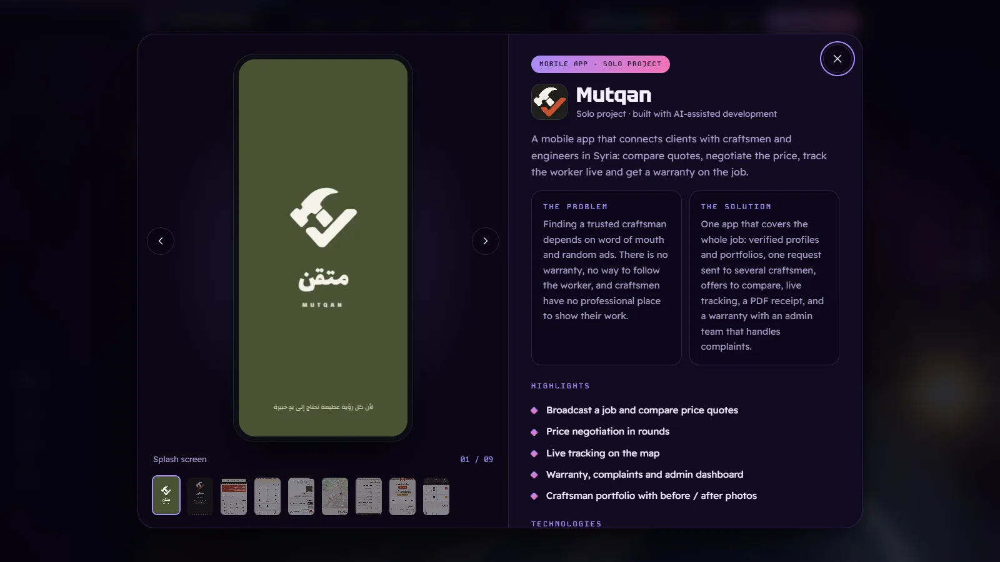
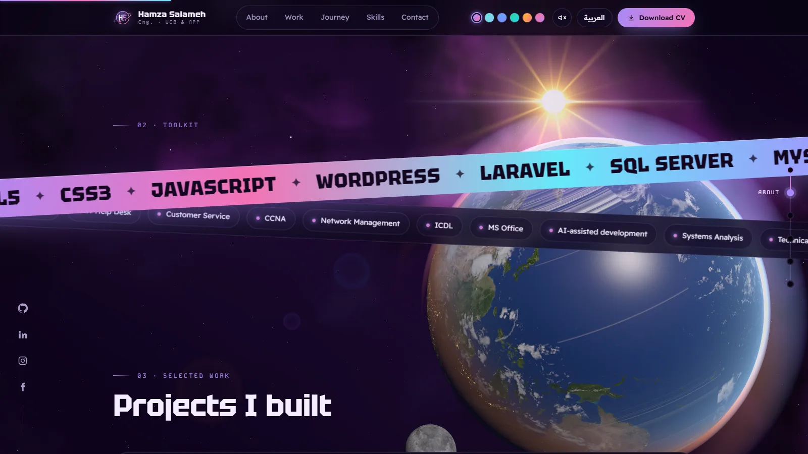
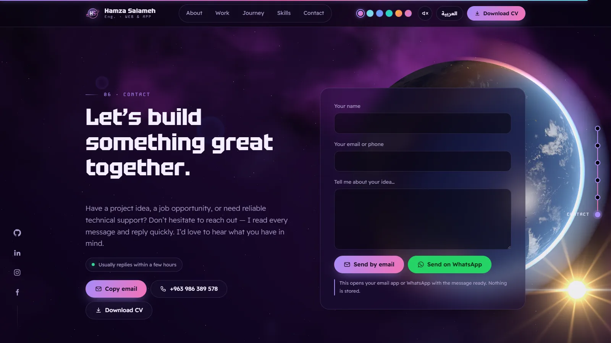
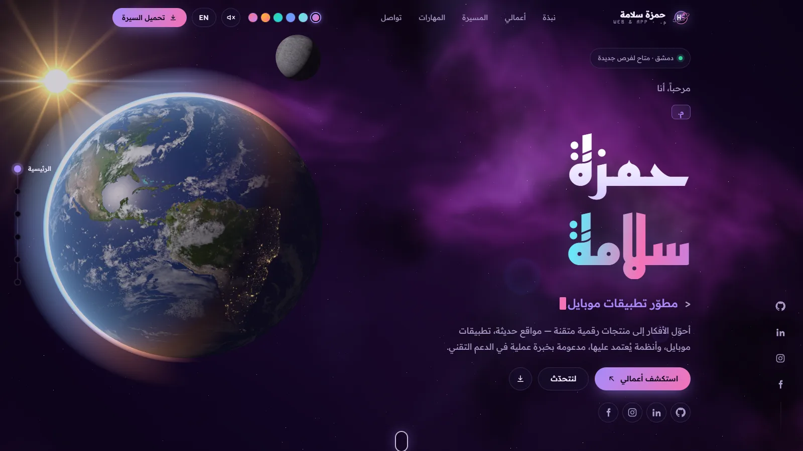
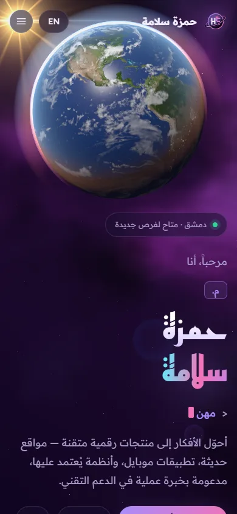

<div align="center">

# 🪐 Eng. Hamza Salameh — Portfolio

**Web & mobile app developer · IT engineering assistant · Informatics Engineering student**

An interactive, bilingual (Arabic / English) portfolio set in a real-time 3D space scene:
a photorealistic Earth, a moving sun and moon, and a procedural nebula — all driven by your scroll.

[English](#-english) · [العربية](#-بالعربية)



</div>

---

## 🇬🇧 English

### About Hamza

**Hamza Salameh** is an IT engineering assistant and web & mobile app developer from **Damascus, Syria**.
He graduated from the Information Technology (IT) department at **Damascus Training Center (DTC) — UNRWA** in 2026
and is now continuing his **Informatics Engineering** degree at the **Syrian Virtual University**.

He builds websites, mobile apps and data-driven systems, and brings hands-on experience in **technical & IT support,
customer service and networking fundamentals**. He uses AI tools in his projects to work faster and with more precision.

- 📍 Damascus, Syria — available for new opportunities
- 📧 hamzaeng444@gmail.com · 📱 +963 986 389 578
- 🔗 [GitHub](https://github.com/Eng-hamza-salameh) · [LinkedIn](https://www.linkedin.com/in/%D8%AD%D9%85%D8%B2%D8%A9-%D8%B3%D9%84%D8%A7%D9%85%D8%A9-6a2ab9422) · [Instagram](https://www.instagram.com/_hamza_salameh_) · [Facebook](https://www.facebook.com/share/19oSrkVRVD/)

#### Featured projects

| Project | What it is | Built with |
| --- | --- | --- |
| **Mutqan** (formerly *Herafi*) — solo | A mobile app connecting clients with craftsmen and engineers in Syria: price quotes to compare, price negotiation in rounds, live tracking on the map, PDF receipts, warranty, complaints and an admin dashboard. [APK](https://expo.dev/artifacts/eas/9N7iuFuggq9lM-tFmNOsUum6gtcnPFUmYpRBDucts_0.apk) · [Repo](https://github.com/Eng-hamza-salameh/motqan-app) | React Native (Expo), TypeScript, Node.js, Express, MySQL, Socket.IO, JWT — AI-assisted development |
| **Warehouse Management System (WMS)** — group | Built for Damascus Training Center (DTC), UNRWA. Unified item coding and category tree, live balances, department → warehouse approval workflow, five roles, movement documents (receipts, issues, returns, transfers) and reports. Internal system, not published. | — |
| **QMP Warehouse Dashboard** — solo | A trial dashboard for a building-materials company: main and sub warehouse stock, low-stock alerts, movements and reports; Arabic / English with RTL and dark mode. [Live demo](https://Eng-hamza-salameh.github.io/qmp-warehouse-dashboard/) · [Repo](https://github.com/Eng-hamza-salameh/qmp-warehouse-dashboard) | HTML5, CSS3, JavaScript |

#### Education

- **IT Engineering Assistant** — Damascus Training Center (DTC) · UNRWA — graduated 2026 (IT department)
- **Informatics Engineering** — Syrian Virtual University · Damascus — in progress

#### Experience

- **IT Support & Customer Service Trainee** — Dash Net Company · 7 months — resolved client network issues and supervised the team’s daily support work
- **IT Support Center Trainee** — Sarafand School · DTC / UNRWA · 2 months — diagnosed and fixed a wide range of IT issues

#### Volunteering & events

- **Community Engagement Specialist (volunteer)** — EMBS Company — helped organise the “UNRWA First SparkTech” tech event
- **“Next Step” event** — You Can Foundation · Ministry of Social Affairs and Labour (Aug 2026) — self-discovery, leadership and entrepreneurship

#### Skills

| Area | Skills |
| --- | --- |
| Web | HTML5 (advanced), WordPress (intermediate), CSS3 (basics), Laravel (foundational), JavaScript (learning) |
| Systems analysis & design | Systems analysis, requirements gathering, database design (ERD), UML diagrams |
| Databases | SQL Server, MySQL |
| Software & mobile | Flutter, Dart, C# Windows Forms, Python (basics) |
| Networking & IT support | CCNA Routing & Switching (basics), network management, IT help desk, customer service, ICDL (theory & practice) |
| Design & office | Figma UI/UX, MS Office (advanced) |
| Artificial intelligence | AI tools in his projects, AI-assisted development |

#### Certificates

English — Intermediate (DTC) · Customer Service (Dash Net) · IT Support (Sarafand / DTC · UNRWA) · Volunteering (EMBS) · Entrepreneurship (DTC) · Computer Applications (DTC)

---

### About the website

#### Highlights

- **Photorealistic 3D Earth** — 4K NASA day map, city lights on the night side, sun glint on the oceans, drifting clouds with shadows and a thin atmospheric glow that turns warm at the day/night line.
- **A sun that is the real light source** — it travels across the sky as you scroll, so the day/night line sweeps over the planet; it can pass behind the Earth (eclipse), with corona, rays and lens-flare ghosts.
- **The Moon** — orbits the Earth on an inclined orbit and covers a large part of it while you scroll, passing in front of and behind the planet.
- **Procedural 3D space** — a domain-warped nebula with a Milky-Way band and dust lanes, plus thousands of stars you fly through while scrolling (they stretch and brighten on fast scrolls) and occasional shooting stars.
- **Scroll choreography** — every section has its own pose for the Earth and the sun (it becomes a planet horizon under the projects, a sunset at the contact form…), with stacked project cards, word-by-word headings and a filling timeline.
- **6 space themes** — Nebula, Milky Way, Deep space, Aurora, Solar and Crimson; each one recolours the interface and the nebula.
- **Arabic / English** with full RTL support, remembered between visits.
- **Generative lo-fi music** — composed live in the browser (chords, electric piano, light beat, melody), no audio files.
- **Project case studies** — gallery with swipe / arrow keys, problem & solution, highlights and stack, with a clear close (X) button and Esc.
- **Contact form** that opens email or WhatsApp with the message ready — nothing is stored.
- Responsive from phones to wide screens, and respects *prefers-reduced-motion*.

| | |
| --- | --- |
|  |  |
|  |  |
|  |  |

#### Languages

| Language | Used for |
| --- | --- |
| **TypeScript / TSX** | All application logic and React components |
| **GLSL** (OpenGL Shading Language) | GPU shaders: Earth surface, atmosphere, sun, lens flare, nebula and stars |
| **CSS** | Layout, themes (CSS custom properties), animations and responsive design |
| **HTML** | Page shell, SEO meta tags and font loading |

#### Libraries

| Library | Version | Role |
| --- | --- | --- |
| [React](https://react.dev) | 18.3 | UI components and state |
| [React DOM](https://react.dev) | 18.3 | Rendering, including the portal used by the project modal |
| [three.js](https://threejs.org) | 0.170 | WebGL 3D engine for the Earth, moon, sun and space scene |
| [Lenis](https://lenis.darkroom.engineering) | 1.3 | Smooth scrolling and the scroll velocity used for warp effects |

#### Tooling

| Tool | Version | Role |
| --- | --- | --- |
| [Vite](https://vitejs.dev) | 5.4 | Dev server and production build |
| [TypeScript](https://www.typescriptlang.org) | 5.x | Static type checking |
| [@vitejs/plugin-react](https://github.com/vitejs/vite-plugin-react) | 4.x | React fast refresh and JSX transform |
| Node.js + npm | 18+ | Installing packages and running scripts |

#### Browser APIs

- **WebGL 2** (through three.js) — all 3D rendering, using two canvases: one for the space background, one for the Earth
- **Web Audio API** — real-time music synthesis (oscillators, FM synthesis, filters, delay, compressor)
- **IntersectionObserver** — reveal-on-scroll animations and counters
- **ResizeObserver** — re-measuring sections for the scroll choreography
- **Clipboard API** — “Copy email” button
- **localStorage** — remembering the chosen language and theme

#### Fonts (Google Fonts)

- **Tektur** — English display (name and headings)
- **Reem Kufi** — Arabic display (name and headings)
- **Readex Pro** — body text in Arabic and English
- **Kode Mono** — code-style labels

#### Assets & credits

- Earth and Moon textures: NASA *Blue Marble* / *Black Marble* imagery, as distributed with the [three.js examples](https://github.com/mrdoob/three.js/tree/dev/examples/textures/planets).
- The nebula, stars, sun, logo, icons and music are generated in code.
- Project screenshots and logos belong to their respective projects.

---

### Getting started

**Requirements:** Node.js 18 or newer.

```bash
npm install        # install dependencies
npm run dev        # start the dev server → http://localhost:5173
npm run build      # type-check and build for production → dist/
npm run preview    # preview the production build
```

### Project structure

```
hamza-portfolio/
├── index.html                 # page shell, meta tags, Google Fonts
├── public/
│   ├── Hamza_Salameh_CV.pdf   # downloadable CV
│   ├── favicon.svg
│   ├── brand/                 # project logos
│   ├── shots/                 # project screenshots
│   └── textures/              # Earth (2K + 4K) and Moon maps
├── docs/                      # screenshots used in this README
└── src/
    ├── main.tsx               # entry point
    ├── App.tsx                # page composition
    ├── styles.css             # themes, layout and animations
    ├── components/
    │   ├── Space.tsx          # 3D nebula + star field background
    │   ├── Earth.tsx          # Earth, sun, moon and scroll choreography
    │   ├── Chrome.tsx         # preloader, header, theme switcher, music, rails, shooting stars
    │   ├── Sections.tsx       # hero, about, toolkit bands, journey, skills, contact
    │   ├── Projects.tsx       # project cards and case-study modal
    │   └── Icons.tsx          # logo and SVG icons
    └── lib/
        ├── data.ts            # ALL content (AR/EN), links, projects, themes
        ├── i18n.tsx           # language context and RTL switching
        ├── scroll.ts          # Lenis setup and section progress helpers
        └── audio.ts           # generative lo-fi music
```

### Customising

- **Texts, links, projects, journey, skills** → `src/lib/data.ts` (every text has `en` and `ar`).
- **Theme colours** → `themes` in `src/lib/data.ts` (nebula palette) and the top of `src/styles.css` (interface colours).
- **Earth / sun position per section** → the `DESKTOP` and `MOBILE` pose tables at the top of `src/components/Earth.tsx`.
- **CV** → replace `public/Hamza_Salameh_CV.pdf` (keep the same name).

### Deployment

`npm run build` produces a static site in `dist/` that can be hosted anywhere:

- **Vercel / Netlify** — import the repository; build command `npm run build`, output directory `dist`.
- **GitHub Pages** — the site uses root paths (`/textures/…`), so it works out of the box on a user site
  (a repository named `<username>.github.io`). For a project site (`<username>.github.io/<repo>/`) set `base` in
  `vite.config.ts` and make the asset paths relative first.

---

## 🇸🇾 بالعربية

<div dir="rtl">

### عن حمزة

**م. حمزة سلامة** مساعد مهندس معلوماتية ومطوّر مواقع وتطبيقات موبايل من **دمشق، سوريا**.
تخرّج من قسم المعلوماتية (IT) في **معهد دمشق المتوسط (DTC) التابع للأونروا** عام 2026،
ويتابع حالياً دراسة **هندسة المعلوماتية** في **الجامعة الافتراضية السورية**.

يطوّر مواقع وتطبيقات موبايل ويبني أنظمة لإدارة البيانات، ولديه خبرة عملية في **الدعم الفني والتقني،
وخدمة العملاء، وأساسيات الشبكات**، ويوظّف أدوات الذكاء الاصطناعي في مشاريعه ليعمل بسرعة ودقة أعلى.

- 📍 دمشق، سوريا — متاح لفرص جديدة
- 📧 hamzaeng444@gmail.com · 📱 ‎+963 986 389 578

#### المشاريع المميّزة

- **متقن** (سابقاً «حرفي») — مشروع فردي: تطبيق موبايل يربط الزبون بالحرفي والمهندس والمقاول في سوريا؛ مقارنة عروض الأسعار، التفاوض على السعر، التتبّع المباشر على الخريطة، إيصال PDF، كفالة وشكاوى ولوحة إدارة.
  التقنيات: React Native (Expo)، TypeScript، Node.js، Express، MySQL، Socket.IO، JWT — مبني بالتطوير بمساعدة الذكاء الاصطناعي.
- **نظام إدارة المستودعات (WMS)** — مشروع جماعي لمعهد دمشق المتوسط (DTC) / الأونروا: ترميز موحّد للمواد وشجرة تصنيف، أرصدة لحظية، مسار موافقات من القسم إلى المستودع، خمسة أدوار بصلاحيات مستقلة، سندات حركة وتقارير. نظام داخلي غير منشور.
- **لوحة مستودعات QMP** — مشروع فردي: لوحة تجريبية لشركة مواد بناء لعرض مخزون المستودع الرئيسي والفرعي وتنبيهات النقص والحركات والتقارير، بالعربية والإنجليزية مع وضع داكن.
  التقنيات: HTML5، CSS3، JavaScript.

#### التعليم

- **مساعد مهندس معلوماتية** — معهد دمشق المتوسط (DTC) · الأونروا — تخرّج 2026 من قسم المعلوماتية (IT)
- **هندسة المعلوماتية** — الجامعة الافتراضية السورية · دمشق — قيد الدراسة

#### الخبرة العملية

- **متدرّب دعم تقني وخدمة عملاء** — شركة داش نت · 7 أشهر — حلّ مشاكل الشبكات للعملاء والإشراف على سير عمل فريق الدعم اليومي
- **متدرّب في مركز الدعم التقني** — مدرسة صرفند · DTC / الأونروا · شهران — تشخيص وحل مجموعة واسعة من أعطال تقنية المعلومات

#### التطوّع والفعاليات

- **أخصائي مشاركة مجتمعية (تطوّع)** — شركة EMBS — ساهم في تنظيم فعالية «UNRWA First SparkTech» التقنية
- **فعالية «الخطوة التالية»** — مؤسسة يو كان · وزارة الشؤون الاجتماعية والعمل (آب 2026) — اكتشاف الذات والقيادة وريادة الأعمال

#### المهارات

- **الويب:** HTML5، WordPress، CSS3، Laravel، JavaScript
- **تحليل وتصميم النظم:** تحليل النظم، جمع المتطلبات، تصميم قواعد البيانات (ERD)، مخططات UML
- **قواعد البيانات:** SQL Server، MySQL
- **البرمجيات والموبايل:** Flutter، Dart، C# Windows Forms، Python
- **الشبكات والدعم التقني:** CCNA، إدارة الشبكات، الدعم الفني، خدمة العملاء، ICDL (عملي ونظري)
- **التصميم والمكتب:** Figma UI/UX، MS Office
- **الذكاء الاصطناعي:** أدوات الذكاء الاصطناعي في المشاريع، التطوير بمساعدة الذكاء الاصطناعي

#### الشهادات

اللغة الإنجليزية — متوسط (DTC) · خدمة العملاء (داش نت) · الدعم التقني (صرفند / DTC · UNRWA) · التطوّع (EMBS) · ريادة الأعمال (DTC) · تطبيقات حاسوبية (DTC)

---

### عن الموقع

#### أبرز الميزات

- **كرة أرضية ثلاثية الأبعاد واقعية:** خرائط ناسا بدقة 4K، أضواء المدن على الجهة الليلية، لمعة الشمس على المحيطات، غيوم متحركة مع ظلالها، وغلاف جوي رفيع يميل للبرتقالي عند خط الليل والنهار.
- **شمس هي مصدر الضوء الحقيقي:** تتحرك في السماء مع السكرول فيتحرك خط الليل والنهار على الأرض، ويمكن أن تمرّ خلف الأرض (كسوف)، مع هالة وأشعة وانعكاسات عدسة.
- **القمر:** يدور حول الأرض بمدار مائل ويقطع جزءاً كبيراً منه مع السكرول، فيمرّ أمام الأرض وخلفها.
- **فضاء ثلاثي الأبعاد مولَّد برمجياً:** سديم ودرب تبانة وغبار كوني، وآلاف النجوم التي تطير بينها أثناء السكرول، وشهب تظهر بين حين وآخر.
- **حركة مدروسة مع السكرول:** لكل قسم وضعية خاصة للأرض والشمس، مع كروت مشاريع تتراكب فوق بعضها، وعناوين تظهر كلمة كلمة، وخط زمني يمتلئ.
- **6 ألوان فضائية:** سديم، درب التبانة، الفضاء العميق، شفق، شمسي، قرمزي.
- **عربي / إنجليزي** مع دعم كامل للاتجاه من اليمين لليسار.
- **موسيقى lo-fi مولَّدة مباشرة في المتصفح** بدون أي ملف صوتي.
- **تفاصيل كل مشروع** في نافذة مع معرض صور وزر إغلاق (X) واضح.
- **نموذج تواصل** يفتح الإيميل أو الواتساب والرسالة جاهزة، ولا يحفظ أي بيانات.
- متجاوب مع كل الشاشات من الموبايل للشاشات العريضة.

#### اللغات المستخدمة

- **TypeScript / TSX:** كل منطق التطبيق ومكوّنات React
- **GLSL:** برامج كرت الشاشة (Shaders) للأرض والغلاف الجوي والشمس والسديم والنجوم
- **CSS:** التصميم والألوان والحركات والتجاوب مع الشاشات
- **HTML:** هيكل الصفحة ووسوم SEO وتحميل الخطوط

#### المكتبات

- **React 18.3** و **React DOM 18.3:** بناء الواجهة
- **three.js 0.170:** محرك الرسم ثلاثي الأبعاد (WebGL)
- **Lenis 1.3:** السكرول الناعم وسرعة السكرول المستخدمة في المؤثرات

#### الأدوات

- **Vite 5.4:** خادم التطوير وبناء النسخة النهائية
- **TypeScript 5:** فحص الأنواع
- **‎@vitejs/plugin-react:** دعم React
- **Node.js + npm:** تثبيت الحزم وتشغيل الأوامر

#### واجهات المتصفح المستخدمة

WebGL 2 للرسم ثلاثي الأبعاد · Web Audio API لتوليد الموسيقى · IntersectionObserver لحركات الظهور · ResizeObserver · Clipboard API لنسخ الإيميل · localStorage لحفظ اللغة واللون

#### الخطوط

Tektur للعناوين الإنجليزية · Reem Kufi للعناوين العربية · Readex Pro للنصوص · Kode Mono للعناوين البرمجية الصغيرة

### التشغيل

```bash
npm install        # تثبيت الحزم
npm run dev        # تشغيل الموقع ← http://localhost:5173
npm run build      # بناء النسخة النهائية في مجلد dist
```

### التعديل على المحتوى

- **كل النصوص والروابط والمشاريع والمسيرة والمهارات:** في ملف `src/lib/data.ts`، ولكل نص نسخة `ar` ونسخة `en`.
- **الألوان:** `themes` في `src/lib/data.ts` وأعلى ملف `src/styles.css`.
- **مكان الأرض والشمس بكل قسم:** جدولا `DESKTOP` و `MOBILE` أعلى ملف `src/components/Earth.tsx`.
- **السيرة الذاتية:** استبدل `public/Hamza_Salameh_CV.pdf` بنفس الاسم.

</div>

---

<div align="center">

© 2026 Eng. Hamza Salameh — designed and built in Damascus.

</div>
